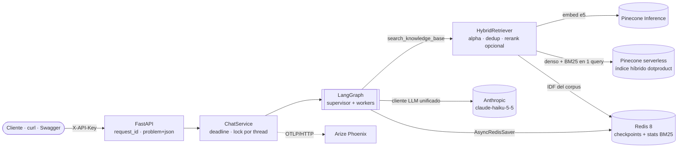
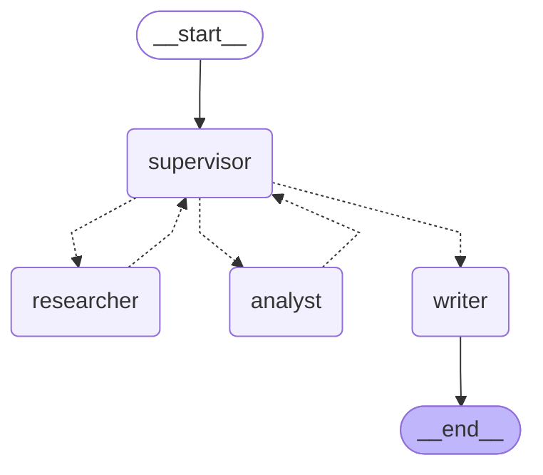

# The Intelligence System

[](https://github.com/rubylial/ai-engineering/actions/workflows/intelligence-system.yml)

Asistente de AI Engineering de grado producción: responde con **citas verificables** sobre una
base de conocimiento (RAG híbrido en Pinecone), resuelve **cálculos técnicos** con herramientas
validadas y coordina todo con un **Supervisor en LangGraph**. Se expone como API FastAPI y cada
request deja una **traza completa en Arize Phoenix**.

Entrega final del curso de AI Engineering. Integra y refactoriza las pre-entregas del repo
(cliente LLM unificado, RAG, agentes) en un solo sistema que se levanta con `./run.sh`.

| | |
| --- | --- |
| Runtime | Python 3.12 · uv · FastAPI · asyncio de punta a punta |
| LLM | Cliente async unificado (Factory) → Anthropic `claude-haiku-5-5` (OpenAI como alternativa) |
| RAG | Pinecone serverless, índice híbrido (denso e5 + BM25 disperso), Pinecone Inference |
| Agentes | LangGraph `StateGraph`: supervisor + researcher + analyst + writer, handoffs con `Command` |
| Persistencia | `AsyncRedisSaver` sobre Redis 8 (conversaciones sobreviven reinicios) |
| Observabilidad | Arize Phoenix + OpenInference · logs JSON con `request_id`/`thread_id`/`trace_id` |
| Calidad | 131 tests unitarios + 4 de integración · `ruff` limpio · evaluación de retrieval y smoke de concurrencia reproducibles (`make evidence`) |

---

## Quickstart

Requisitos: Docker con Compose v2, una clave de **Anthropic** y una de **Pinecone** (el plan
gratuito alcanza). No hace falta OpenAI.

```bash
cp .env.example .env        # completá ANTHROPIC_API_KEY, PINECONE_API_KEY y API_KEY
./run.sh                    # build + redis + phoenix + api + espera salud + ingesta idempotente
```

`run.sh` valida el `.env`, levanta los tres servicios con `docker compose up --wait`, verifica
`GET /ready` (Redis, Pinecone y LLM) e ingesta el corpus. Al terminar:

- API y Swagger: <http://localhost:8000/docs>
- Phoenix: <http://localhost:6006>

```bash
export API_KEY=...   # el mismo valor del .env
curl -s -X POST http://localhost:8000/v1/chat \
  -H "X-API-Key: $API_KEY" -H "Content-Type: application/json" \
  -d '{"message": "¿Para qué sirve asyncio.Semaphore cuando llamo a un LLM?"}'
```

El paso a paso detallado (con troubleshooting) está en [docs/RUNBOOK.md](docs/RUNBOOK.md).

---

## Arquitectura



Recorrido de un `POST /v1/chat`:

1. El middleware asigna `request_id` (o respeta el `X-Request-ID` del cliente) y lo liga a los logs.
2. `ChatService` abre el span raíz `chat.turn` (con `request_id`, `thread_id` y `session.id`),
   toma el lock del thread y ejecuta el grafo con un deadline (`AGENT_REQUEST_TIMEOUT_S`).
3. El **supervisor** decide con salida estructurada `{next, reason, task}` quién trabaja.
4. Los **workers** corren con timeout propio, devuelven evidencia tipada y vuelven al supervisor.
5. El **writer** redacta con marcadores `[n]`; el código valida cada cita contra la evidencia real.
6. El checkpoint queda en Redis; la respuesta incluye `citations`, `steps`, `trace_id` y `request_id`.

## Grafo de agentes

Generado con `graph.get_graph().draw_mermaid()` sobre el grafo real (`make graph`), no dibujado a mano:

<!-- GRAPH:START -->

<!-- GRAPH:END -->

| Nodo | Rol | Escribe en el estado |
| --- | --- | --- |
| `supervisor` | Ruteo con `SupervisorDecision {next, reason, task}`; reglas de presupuesto y anti-bucle | `plan`, `next`, `current_task` |
| `researcher` | Tool `search_knowledge_base` + grader LLM que descarta fragmentos irrelevantes | `evidence`, `step_count`, `error` |
| `analyst` | Ciclo ReAct con 5 tools de cálculo (chunks, métricas, RRF, memoria, similitud) | `evidence`, `step_count`, `error` |
| `writer` | Respuesta final con citas validadas; sin evidencia responde que no sabe | `messages`, `answer`, `citations`, `grounded` |

Cada nodo solo puede escribir su parcela (`NODE_OWNERSHIP` en `agents/state.py`); el runtime lo
verifica en cada paso. Límites: `AGENT_MAX_STEPS` (pasos de workers), `AGENT_RECURSION_LIMIT`
(supersteps de LangGraph), `AGENT_NODE_TIMEOUT_S` (por nodo, con `asyncio.timeout`) y reintentos
con backoff exponencial + jitter (tenacity) ante errores transitorios del LLM y de Pinecone.

---

## API

Todos los modelos de entrada/salida son Pydantic v2 con ejemplos en OpenAPI (`/docs`).
Autenticación: header `X-API-Key`. Errores: `application/problem+json`
`{type, title, status, detail, request_id, trace_id}`.

| Método | Ruta | Qué hace |
| --- | --- | --- |
| GET | `/health` | Liveness (sin auth) |
| GET | `/ready` | Verifica Redis, Pinecone y LLM; 503 con el detalle de qué falta |
| POST | `/v1/ingest` | Ingesta idempotente (upsert por `doc_id` + hash de contenido) |
| POST | `/v1/chat` | `{thread_id?, message, filters?, deadline_s?}` → `{thread_id, answer, grounded, citations[], steps[], trace_id, request_id}` |
| POST | `/v1/chat/stream` | SSE: `step` · `token` · `citation` · `done` · `error` |
| GET | `/v1/threads/{thread_id}` | Historial persistido en el checkpointer |

```bash
H='-H "X-API-Key: $API_KEY" -H "Content-Type: application/json"'

# Salud y readiness
curl -s localhost:8000/health
curl -s localhost:8000/ready | python3 -m json.tool

# Ingesta (la segunda vez devuelve chunks_upserted=0)
curl -s -X POST localhost:8000/v1/ingest -H "X-API-Key: $API_KEY" \
  -H "Content-Type: application/json" -d '{"from_corpus": true}'

# Pregunta multi-paso (researcher + analyst)
curl -s -X POST localhost:8000/v1/chat -H "X-API-Key: $API_KEY" -H "Content-Type: application/json" \
  -d '{"thread_id": "demo-1", "message": "Según la documentación, ¿con qué chunk size conviene empezar? Calculá cuántos chunks salen de 12000 tokens."}'

# Continuación del mismo thread + historial
curl -s -X POST localhost:8000/v1/chat -H "X-API-Key: $API_KEY" -H "Content-Type: application/json" \
  -d '{"thread_id": "demo-1", "message": "¿Y cuánto overlap recomienda?"}'
curl -s localhost:8000/v1/threads/demo-1 -H "X-API-Key: $API_KEY"

# Filtros de metadatos y streaming
curl -s -X POST localhost:8000/v1/chat -H "X-API-Key: $API_KEY" -H "Content-Type: application/json" \
  -d '{"message": "¿Qué ventaja tiene BM25?", "filters": {"categories": ["retrieval"]}}'
curl -N -X POST localhost:8000/v1/chat/stream -H "X-API-Key: $API_KEY" -H "Content-Type: application/json" \
  -d '{"message": "¿Qué es Reciprocal Rank Fusion?"}'
```

---

## Diseño del RAG

- **Corpus**: los 7 documentos de la pre-entrega 4 (asyncio, embeddings, LCEL, ChromaDB,
  Pinecone, retrieval híbrido, métricas), en `data/corpus/` con front matter YAML
  (`doc_id`, `title`, `category`, `tags`). Se puede ingestar más vía `POST /v1/ingest`.
- **Chunking**: `MarkdownHeaderTextSplitter` (sección como metadato para citar) + recursivo con
  overlap. Tamaño en caracteres (`RAG_CHUNK_SIZE=1500`, `RAG_CHUNK_OVERLAP=150`).
- **IDs deterministas**: `<doc_id>#<sha256(texto)[:16]>`. Mismo texto, mismo id: la reingesta
  no vuelve a embeber (costo cero) y los chunks que desaparecen del documento se borran.
- **Embeddings**: Pinecone Inference `multilingual-e5-large` (1024 dims), async y por lotes con
  semáforo. Sin torch en la imagen y sin OpenAI.
- **Híbrido nativo**: índice con los campos reservados `_values` (dense, `dotproduct`) y
  `_sparse_values` (sparse), servido por la API de vectores de Pinecone 10.x. La consulta
  combina `alpha·denso + (1−alpha)·BM25` en una sola llamada (`RAG_HYBRID_ALPHA=0.7`).
- **BM25 propio**: el componente TF va en el vector del documento y el IDF en el de la
  consulta. Las estadísticas del corpus viven en Redis, idempotentes por `chunk_id`.
- **Filtros**: lista blanca tipada (`doc_ids`, `categories`) traducida a `$in`/`$and`.
- **Dedup + rerank**: dedup por hash de contenido; rerank opcional con `bge-reranker-v2-m3`.
- **Evaluación**: `make eval` compara híbrido vs. solo denso vs. solo BM25 (P@5, R@5, MRR) con un
  golden set de 16 preguntas tipificadas (`concepto`, `termino_exacto`, `parafrasis`, en
  `data/golden_set.json`) y escribe [docs/traces/evaluation.md](docs/traces/evaluation.md) con la
  tabla global y P@5 por tipo. La tipificación es lo que hace visible el tradeoff: el término
  exacto favorece a BM25, la paráfrasis al denso, y el híbrido no tiene el peor caso de ninguno.
  Sin Pinecone: `uv run python scripts/evaluate_retrieval.py --ingest-corpus` con
  `VECTOR_STORE=memory` corre la misma evaluación offline (BM25 real, embeddings por hashing).

## Anti-alucinación

1. El grader del researcher descarta fragmentos que no responden; índices inventados se ignoran en código.
2. Sin evidencia, el writer responde que no sabe **sin llamar al LLM**.
3. Toda afirmación lleva `[n]`; los marcadores que no apuntan a evidencia real se eliminan.
4. Sin ninguna cita válida, la respuesta se reemplaza por la abstención (`grounded=false`).

## Persistencia

`AsyncRedisSaver` guarda cada checkpoint por `thread_id` en Redis 8 (AOF activado, volumen
`redis-data`). Reiniciar la API (o todo el compose) no pierde conversaciones: probado en
`tests/integration/test_redis_persistence.py` contra un Redis 8.10 real.
`CHECKPOINT_TTL_MINUTES` habilita expiración por inactividad.

## Observabilidad

- **Trazas**: `phoenix.otel.register` + instrumentadores OpenInference de LangChain/LangGraph,
  Anthropic y OpenAI. Raíz `chat.turn` con input, output, `request_id`, `thread_id` y
  `session.id`; un span `agent.<worker>` por nodo con el atributo `worker`; span `RETRIEVER`
  con los documentos recuperados; spans `TOOL` y `LLM` anidados.
- **Sesiones**: `session.id = thread_id`, así Phoenix agrupa los turnos de una conversación.
- **Logs**: JSON (structlog) con `request_id`, `thread_id`, `trace_id` y `span_id` en cada línea.
- **Evidencia**: `make scenarios` corre 6 escenarios y escribe [docs/traces/traces.md](docs/traces/traces.md)
  con el link, la latencia y el `trace_id` de cada uno; ahí están las instrucciones exactas de qué
  capturar. `make load` lanza 5 turnos concurrentes y escribe [docs/traces/load.md](docs/traces/load.md)
  (p50, p95, wall time y paralelismo efectivo). `make logs-trace REQ=req_…` imprime las líneas JSON
  de un request para mostrar la correlación `request_id` ↔ `trace_id` con la traza de Phoenix.
  `make evidence` encadena scenarios + eval + load.

## Testing

```bash
make install          # uv sync --frozen
make test             # 131 tests unitarios: LLM, Pinecone y Redis son dobles (sin red)
make lint             # ruff check + format --check
make test-integration # 3 tests contra el Redis del compose (+1 contra Pinecone si exportás PINECONE_API_KEY)
make evidence         # con el stack arriba: scenarios + eval + load → docs/traces/
```

Los unitarios cubren cliente LLM (reintentos, bucle de reparación de salida estructurada,
formato de wire de Anthropic/OpenAI), chunking, BM25, ingesta idempotente, retriever híbrido,
store de Pinecone contra un doble del SDK, tools, supervisor, workers, persistencia por thread,
deadlines, streaming, API completa, atributos de las trazas y el informe de evaluación.

Los de integración se saltan por defecto (`RUN_INTEGRATION=1` los activa): tres prueban que una
conversación sobrevive a recrear el saver y el grafo contra un Redis 8 real, y uno hace un
round-trip híbrido (upsert + query con denso y sparse) contra Pinecone real.

## Resultados medidos

Corrida de verificación del 2026-11-06 en WSL2 + Docker Desktop, con Anthropic, Pinecone y
Redis reales (el detalle está en [docs/ENTREGA.md](docs/ENTREGA.md) §1):

| Qué | Resultado |
| --- | --- |
| `./run.sh` | Imagen construida, 3 contenedores healthy, `/ready` 200 con Redis + Pinecone + LLM + grafo OK |
| Ingesta | 7 documentos → 55 chunks en 4.3 s; la segunda corrida: 0 subidos, 55 sin cambios (idempotente) |
| `make scenarios` | 6/6 en dos corridas distintas; multi-paso con cita de documento **y** de cálculo (`estimar_chunks` → 27) |
| Persistencia | `docker compose restart api` y `GET /v1/threads/persist-test` devolvió los 2 mensajes y su `checkpoint_id` |
| `make test` / `make lint` | 131 passed, 4 skipped · ruff limpio |
| `make eval` (golden v1, 5 preguntas) | híbrido P@5 0.680 · denso 0.640 · BM25 0.680; R@5 y MRR = 1.000 en los tres |

Esa primera evaluación saturaba (R@5 = MRR = 1.0): con 5 preguntas muy distintivas cualquier
variante encuentra el documento correcto en la primera posición. Por eso el golden set pasó a
16 preguntas tipificadas; la tabla vigente (global y por tipo) es la que genera `make eval` en
[docs/traces/evaluation.md](docs/traces/evaluation.md), y la de concurrencia la de `make load`
en [docs/traces/load.md](docs/traces/load.md).

Un hallazgo de esa corrida: la variante "solo BM25" (alpha=0.0) fallaba con `400 Cannot query
index with dense 'vector_type' with only sparse vector`. `hybrid_scale` omitía el vector denso
y el test unitario, que usa el store en memoria, fijaba justo ese comportamiento. El índice
híbrido de Pinecone exige un vector denso en toda consulta, así que ahora alpha=0.0 manda el
denso escalado a cero (aporta 0 al dotproduct: el score queda puro BM25). No afectaba a la API
(alpha=0.7), pero sí a la evaluación, y es el tipo de error que solo aparece contra el backend real.

### Evidencia en `docs/traces/`

| Archivo | Lo genera | Qué prueba |
| --- | --- | --- |
| `traces.md` + `scenario_results.json` | `make scenarios` | 6 escenarios con esperado/obtenido, latencia, `request_id` y `trace_id` |
| `evaluation.md` | `make eval` | P@5 / R@5 / MRR global y por tipo de pregunta, 3 variantes |
| `load.md` | `make load` | 5 turnos concurrentes: p50, p95, wall time, paralelismo efectivo |
| `01-…png` … `11-…png` | Capturas de Phoenix (manual) | Árbol de spans, atributos, sesión por `thread_id`, error con `trace_id`, logs correlacionados |

## Variables de entorno

Todas están en [.env.example](.env.example), comentadas. Las principales:

| Variable | Default | Para qué |
| --- | --- | --- |
| `ANTHROPIC_API_KEY` · `PINECONE_API_KEY` · `API_KEY` | — | Obligatorias |
| `LLM_MODEL_SUPERVISOR` · `LLM_MODEL_WORKER` | `claude-haiku-5-5` | Modelos por rol |
| `PINECONE_INDEX_NAME` · `PINECONE_NAMESPACE` | `intelligence-system` · `ai-engineering-docs` | Índice híbrido y partición |
| `RAG_HYBRID_ALPHA` | `0.7` | Peso denso vs. BM25 |
| `RAG_CHUNK_SIZE` · `RAG_CHUNK_OVERLAP` | `1500` · `150` | Chunking (caracteres) |
| `AGENT_MAX_STEPS` · `AGENT_RECURSION_LIMIT` | `4` · `25` | Límites del grafo |
| `AGENT_NODE_TIMEOUT_S` · `AGENT_REQUEST_TIMEOUT_S` | `45` · `120` | Timeouts |
| `CHECKPOINTER_BACKEND` · `REDIS_URL` | `redis` | Persistencia |
| `PHOENIX_COLLECTOR_ENDPOINT` · `PHOENIX_PROJECT_NAME` | `http://localhost:6006` · `intelligence-system` | Trazas |

## Estructura

```
src/intelligence_system/
  config.py            Settings (pydantic-settings): única fuente de configuración
  container.py         composition root: clientes compartidos del lifespan
  llm/                 cliente async unificado + Factory (pre-entrega 1, extendido)
  rag/                 loaders, chunking, embeddings, sparse (BM25), vector_store, retriever, ingest
  agents/              state, supervisor, workers/, tools/, graph, service, checkpointer
  api/                 app (lifespan), routers/, schemas, middleware, errors
  observability/       logging JSON, tracing Phoenix/OpenInference, contexto de correlación
scripts/               ingest · run_scenarios · load_smoke · export_graph · evaluate_retrieval
tests/                 unit/ (sin red) · integration/ (RUN_INTEGRATION=1)
docs/                  RUNBOOK · ENTREGA (reporte final) · ARCHITECTURE · adr/ · traces/
docs/traces/           traces.md + scenario_results.json (escenarios) · evaluation.md · load.md · capturas 01–11
```

## Rúbrica → evidencia en el repo

La rúbrica oficial no venía en el enunciado; esta tabla mapea los 7 puntos del entregable y las
reglas duras a la evidencia.

| Requisito | Evidencia |
| --- | --- |
| 1. Integración de pre-entregas (RAG + agentes + cliente unificado) | `llm/` (pre-entrega 1), `rag/` (3 y 4), `agents/` (5 + ejercicios); mapa en [docs/ARCHITECTURE.md](docs/ARCHITECTURE.md) |
| 2. Refactor async (LLM, vector DB, Redis) | `AsyncAnthropic`/`AsyncOpenAI`, `PineconeAsyncio`/`IndexAsyncio`, `redis.asyncio`, `AsyncRedisSaver`; regla `ASYNC` de ruff activa; paralelismo medido en [docs/traces/load.md](docs/traces/load.md) |
| 3. Persistencia que sobrevive reinicios | `agents/checkpointer.py`, `tests/integration/test_redis_persistence.py`, prueba manual con `docker compose restart api` (Resultados medidos) |
| 4. Pydantic v2 en cada borde | `api/schemas`, `agents/schemas.py`, `agents/tools/*` (`args_schema` + salidas), `rag/schemas.py`, `config.py` |
| 5. ≥5 pruebas con trazas en Phoenix | `scripts/run_scenarios.py` (6 escenarios), [docs/traces/traces.md](docs/traces/traces.md), [evaluation.md](docs/traces/evaluation.md), [load.md](docs/traces/load.md), capturas 01–11 |
| 6. README con Mermaid del grafo + documentación | Este README (grafo generado), `docs/` |
| 7. Despliegue con una instrucción | `./run.sh` (o `docker compose up --wait`) |
| Zero hard-coding | `config.py` + `.env.example` (test que verifica que cubre cada setting) |
| Caja de cristal | `observability/tracing.py`, `api/middleware.py`, tests de atributos de spans y logs |
| Supervisor con salida estructurada + `Command` | `agents/supervisor.py`, `agents/graph.py` |
| No alucina sin evidencia | `agents/workers/writer.py`, escenario 3 |

## Limitaciones conocidas

- El lock por thread es por proceso: con varias réplicas de la API haría falta un lock distribuido.
- BM25 usa una tokenización simple (sin stemming); el componente denso cubre la morfología.
- Las estadísticas BM25 viven en Redis: después de `make clean` hay que reingestar (`make ingest`)
  para reconstruirlas; no se vuelve a embeber nada porque los vectores siguen en Pinecone.
- `LLM_PROVIDER=fake` existe solo para pruebas sin red: sus respuestas son heurísticas.
- El golden set tiene 16 preguntas sobre 7 documentos: las métricas a nivel documento son
  orientativas (sirven para comparar variantes, no para afirmar una precisión absoluta).
- Sin CD ni despliegue cloud (fuera del alcance de la evaluación). La CI del repo corre lint y
  tests unitarios en cada push que toque esta carpeta.
