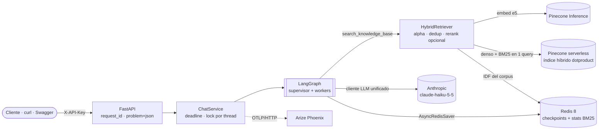
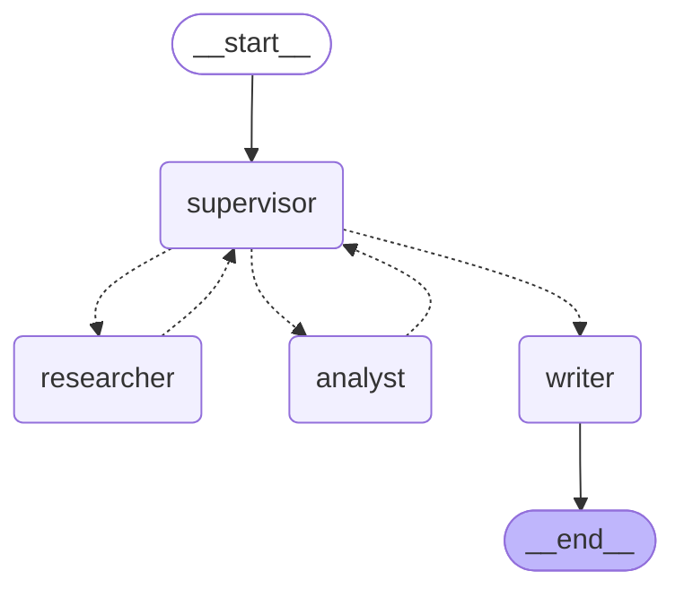

# Runbook — The Intelligence System

Despliegue local, verificación, evidencia y operación. Última verificación: 2026-11-05.

1. [Qué es el sistema](#1-qué-es-el-sistema)
2. [Arquitectura](#2-arquitectura)
3. [Requisitos previos](#3-requisitos-previos)
4. [Despliegue paso a paso](#4-despliegue-paso-a-paso)
5. [Verificación funcional](#5-verificación-funcional)
6. [Escenarios y evidencia en Phoenix](#6-escenarios-y-evidencia-en-phoenix)
7. [Pruebas y calidad](#7-pruebas-y-calidad)
8. [Operación diaria](#8-operación-diaria)
9. [Troubleshooting](#9-troubleshooting)
10. [Checklist de entrega y commits propuestos](#10-checklist-de-entrega-y-commits-propuestos)

---

## 1. Qué es el sistema

The Intelligence System es un asistente técnico de AI Engineering: responde preguntas con citas
verificables de una base de conocimiento y hace cálculos técnicos con herramientas validadas. Se
expone como una API FastAPI y se levanta en local con un solo comando, `./run.sh`.

| Componente | Qué hace | Tecnología |
| --- | --- | --- |
| API | Recibe preguntas, valida la entrada, autentica con `X-API-Key` y responde JSON o SSE | FastAPI + Pydantic v2 |
| Supervisor | Decide en cada paso qué especialista trabaja, con salida estructurada `{next, reason, task}` | LangGraph + `Command(goto=...)` |
| Researcher | Busca en la base de conocimiento y descarta la evidencia que no responde la pregunta | RAG híbrido (denso + BM25) en Pinecone |
| Analyst | Hace cálculos técnicos llamando herramientas con `args_schema` Pydantic | Ciclo ReAct sobre el cliente LLM unificado |
| Writer | Redacta la respuesta final con citas `[n]`; sin evidencia, responde que no sabe | Cliente LLM unificado con streaming |
| Memoria | Guarda cada conversación por `thread_id` y sobrevive reinicios del servidor | `AsyncRedisSaver` sobre Redis 8 |
| Observabilidad | Una traza por request con `request_id` y `thread_id`; logs JSON con los mismos ids | Arize Phoenix + OpenInference |

El sistema reutiliza el código de las pre-entregas en lugar de reescribirlo:

| Origen | Qué aporta al sistema final |
| --- | --- |
| Pre-entrega 1 | Cliente LLM async unificado con Factory y streaming; se extiende con salida estructurada y tool calling |
| Pre-entrega 3 | Contrato anti-alucinación (respuesta + referencias + `has_answer`), que pasa a ser citas obligatorias |
| Pre-entrega 4 | Corpus de 7 documentos, creación idempotente del índice, chunking con metadatos, métricas P@k/R@k y RRF |
| Pre-entrega 5 | Patrón ReAct, tools con docstrings de cuándo usarlas, errores devueltos como datos y checkpointer inyectado |
| Ejercicios de supervisor y estado compartido | Ruteo con salida estructurada y aislamiento de escritura por nodo |

La pre-entrega 2 (LCEL) no aporta código: la orquestación ahora la hace LangGraph. Quedan fuera
de alcance CI/CD, despliegue en nube y aprobación humana (HITL).

---

## 2. Arquitectura

`docker compose` levanta tres servicios; Pinecone y Anthropic son servicios externos.

| Servicio | Imagen | Puerto del host | Qué guarda | Healthcheck |
| --- | --- | --- | --- | --- |
| `api` | `intelligence-system-api:1.0.0`, construida con el `Dockerfile` | `API_PORT` (8000) | Nada: sin estado | `GET /health` |
| `redis` | `redis:8.10.3` (incluye RedisJSON y RediSearch) | `REDIS_PORT` (6379) | Checkpoints de LangGraph y estadísticas BM25 (volumen `redis-data`, AOF) | `redis-cli ping` |
| `phoenix` | `arizephoenix/phoenix:version-21.0.0` | `PHOENIX_PORT` (6006) | Trazas (volumen `phoenix-data`) | `GET /healthz` |
| Pinecone (SaaS) | — | — | Índice híbrido y embeddings (Pinecone Inference) | `GET /ready` |
| Anthropic (SaaS) | — | — | Modelo `claude-haiku-5-5` | `GET /ready` |



### Grafo de agentes

Generado con `draw_mermaid()` sobre el grafo compilado (`make graph`), no dibujado a mano:



Las flechas punteadas son handoffs con `Command(goto=...)`: el supervisor elige el siguiente nodo,
researcher y analyst siempre vuelven al supervisor y el writer cierra el turno. Límites
configurables: `AGENT_MAX_STEPS` (4 pasos de workers por turno), `AGENT_RECURSION_LIMIT` (25),
`AGENT_NODE_TIMEOUT_S` (45 s por nodo) y `AGENT_REQUEST_TIMEOUT_S` (120 s por turno).

### Recorrido de una request

1. El middleware asigna un `request_id` (o respeta el `X-Request-ID` del cliente), lo liga a los
   logs y lo devuelve en el header `X-Request-ID`.
2. `ChatService` abre el span raíz `chat.turn` con `request_id`, `thread_id` y `session.id`, toma el
   lock del thread y ejecuta el grafo con el deadline del turno.
3. El supervisor decide con salida estructurada `{next, reason, task}` quién trabaja.
4. El researcher embebe la pregunta (e5), consulta Pinecone con una sola query híbrida
   (`alpha·denso + (1−alpha)·BM25`) y un grader LLM descarta lo irrelevante. El analyst resuelve
   cálculos con 5 tools validadas.
5. El writer redacta con marcadores `[n]`; el código valida cada cita contra la evidencia real y,
   sin ninguna válida, responde que no sabe (`grounded=false`).
6. El checkpoint queda en Redis; la respuesta trae `citations`, `steps`, `trace_id` y `request_id`,
   y la traza llega a Phoenix por OTLP/HTTP.

---

## 3. Requisitos previos

Alcanza con Docker y dos API keys: Anthropic (LLM) y Pinecone (vector store + embeddings). La
tercera clave, `API_KEY`, la inventás vos para proteger la API.

| Requisito | Detalle | Cómo verificarlo |
| --- | --- | --- |
| Docker Engine o Docker Desktop | Con Compose v2 (`docker compose`, no `docker-compose`) | `docker compose version` |
| Memoria libre | ~3 GB para los tres contenedores | Panel de Docker Desktop |
| Puertos libres | 8000 (API), 6006 (Phoenix), 6379 (Redis); se cambian en `.env` | `lsof -i :8000` |
| `ANTHROPIC_API_KEY` | Cuenta de Anthropic con crédito; modelo por defecto `claude-haiku-5-5` | `GET /ready` → componente `llm` |
| `PINECONE_API_KEY` | Plan Starter (gratis) alcanza: 1 índice serverless + Pinecone Inference (`multilingual-e5-large`) | `GET /ready` → componente `vector_store` |
| `API_KEY` | Cualquier secreto largo; se manda en el header `X-API-Key` | `curl` con y sin el header |
| Internet saliente | `api.anthropic.com`, `*.pinecone.io`, Docker Hub, `ghcr.io` y PyPI | El primer `./run.sh` descarga imágenes y dependencias |
| Opcional: `uv`, Python 3.12 y `make` | Solo para tests, lint y escenarios fuera de Docker | `uv --version` |

No hace falta OpenAI: los embeddings salen de Pinecone Inference con la misma clave del vector
store. Cada pregunta hace entre 3 y 7 llamadas al LLM (supervisor, grader de evidencia, analyst y
writer), así que conviene empezar con `claude-haiku-5-5` y subir solo el supervisor a
`claude-sonnet-5-5` si el ruteo falla. Ambos figuran como activos en la página de deprecaciones de
Anthropic (consultada el 2026-11-05).

En Windows: usá WSL2 (Ubuntu) con la integración de Docker Desktop activada y trabajá dentro del
filesystem de WSL (`~/`), no en `/mnt/c`.

---

## 4. Despliegue paso a paso

No hace falta conectar ningún repositorio: todo corre en tu máquina con Docker.

### Paso 1. Descomprimir

El zip trae una sola carpeta autocontenida. En el repo del curso quedó como `intelligence_system/`
(guion bajo, como las demás `pre_entrega_N/`), en la raíz, al lado de las pre-entregas y sin
tocar nada de ellas (ADR-0001). Todos los comandos de este runbook se ejecutan desde adentro de
esa carpeta.

```bash
cd ~/ai-engineering/intelligence_system
ls -a                                # Dockerfile  docker-compose.yml  run.sh  src/  tests/  docs/  .env.example …
chmod +x run.sh                      # solo si tu descompresor perdió el permiso de ejecución
```

> Si `ls -a` no muestra `.env.example`, tu descompresor omitió los archivos ocultos: es parte del
> entregable (lo exige `tests/unit/test_config.py`), así que recuperalo del zip con
> `unzip -o <zip> 'intelligence-system/.env.example'` o pedilo de nuevo antes de commitear.

### Paso 2. Configurar `.env`

```bash
cp .env.example .env
openssl rand -hex 32                 # un valor para API_KEY
```

Editá `.env` y completá las tres claves:

| Variable | Valor |
| --- | --- |
| `ANTHROPIC_API_KEY` | Tu clave de Anthropic (consola de Anthropic → API Keys) |
| `PINECONE_API_KEY` | Tu clave de Pinecone (consola de Pinecone → API Keys) |
| `API_KEY` | El valor que generaste; es la clave del header `X-API-Key` |

Todo lo demás tiene valores por defecto. Antes del primer arranque revisá dos cosas:

- `PINECONE_INDEX_NAME=intelligence-system` no puede ser el nombre del índice de la pre-entrega 4
  (cosine, 384 dimensiones): no es compatible. Si el índice no existe, la API lo crea sola
  (serverless, `aws`/`us-east-1`, denso `dotproduct` 1024 + campo sparse).
- Si 8000, 6006 o 6379 están ocupados, cambiá `API_PORT`, `PHOENIX_PORT` o `REDIS_PORT`.

`.env` está en `.gitignore`: nunca lo subas al repo.

### Paso 3. Levantar todo

```bash
./run.sh
```

Qué hace, en orden:

1. Verifica Docker, Compose v2, que el daemon responda y que exista `curl`.
2. Valida `.env`: si no existe lo crea desde el ejemplo y se detiene; si falta una clave, dice cuál.
3. `docker compose up -d --build --wait --wait-timeout 300`: construye la imagen de la API, levanta
   `redis`, `phoenix` y `api`, y espera a que los tres healthchecks pasen.
4. `GET /ready`: Redis responde, el índice de Pinecone existe y es compatible, y el modelo del LLM
   existe con tu clave. Si algo falla, imprime el detalle del componente y se detiene.
5. `POST /v1/ingest {"from_corpus": true}`: ingesta idempotente de los 7 documentos (55 chunks).

Salida esperada al final:

```text
✓ Configuración válida (LLM=anthropic, vector store=pinecone)
▸ Construyendo la imagen y levantando redis, phoenix y api (la primera vez tarda unos minutos)...
✓ Contenedores saludables
▸ Verificando dependencias externas (GET /ready)...
✓ Redis, Pinecone y el LLM responden
▸ Ingesta idempotente del corpus (la segunda vez sube 0 chunks)...
{"documents":7,"chunks_total":55,"chunks_upserted":55,"chunks_unchanged":0,"chunks_deleted":0,"duration_ms":…}
✓ Corpus indexado

✓ The Intelligence System está arriba
  API (Swagger):  http://localhost:8000/docs
  Phoenix:        http://localhost:6006
```

La primera vez tarda varios minutos (descarga de imágenes y dependencias) y puede sumar alrededor
de un minuto mientras Pinecone crea el índice. Las siguientes, segundos.

> **Costo:** la ingesta hace 55 embeddings con Pinecone Inference (entra en el plan gratuito) y
> `/ready` solo consulta que el modelo exista, sin gastar tokens. La segunda ejecución sube 0
> chunks. Para levantar sin ingestar: `SKIP_INGEST=1 ./run.sh`.

### Paso 4. Confirmar

```bash
docker compose ps                    # api, redis y phoenix en estado "healthy"
curl -s localhost:8000/ready | python3 -m json.tool
```

Esperado: `"status": "ready"` y los componentes `redis`, `vector_store`, `llm` y `agent` con
`"ok": true`. Después abrí <http://localhost:8000/docs>, tocá **Authorize**, pegá tu `API_KEY` y
probá `POST /v1/chat` desde Swagger. Phoenix queda en <http://localhost:6006>, proyecto
`intelligence-system`.

Sin `run.sh`, lo mismo en dos comandos: `docker compose up -d --build --wait` y `make ingest`.

---

## 5. Verificación funcional

Variables para copiar y pegar:

```bash
export API_KEY="$(grep -E '^API_KEY=' .env | cut -d= -f2- | tr -d '\r"')"
BASE=http://localhost:8000
H=(-H "X-API-Key: $API_KEY" -H "Content-Type: application/json")
```

| # | Qué probar | Comando | Resultado esperado |
| --- | --- | --- | --- |
| 1 | Liveness | `curl -s $BASE/health` | `{"status":"ok",…}` sin auth |
| 2 | Readiness | `curl -s $BASE/ready` | `"status":"ready"` con 4 componentes OK |
| 3 | Reingesta idempotente | `curl -s -X POST $BASE/v1/ingest "${H[@]}" -d '{"from_corpus": true}'` | `"chunks_upserted":0`, `"chunks_unchanged":55` |
| 4 | Pregunta RAG | ver bloque de abajo | `grounded: true`, citas `kind: "document"` |
| 5 | Multi-paso | ver bloque de abajo | `steps` con `researcher` y `analyst`; citas de documento y de cálculo |
| 6 | Continuación | mismo `thread_id` + `GET /v1/threads/demo-1` | 4 mensajes (2 del usuario, 2 del asistente) |
| 7 | Sin evidencia | `"¿Cuál es la capital de Australia?"` | `grounded: false`, `citations: []`, responde que no sabe |
| 8 | Streaming | `curl -N` a `/v1/chat/stream` | eventos `step` → `token` → `citation` → `done` |
| 9 | Errores | ver bloque de abajo | 401, 422, 404 y 504 como `application/problem+json` |

```bash
# 4. Pregunta RAG
curl -s -X POST $BASE/v1/chat "${H[@]}" \
  -d '{"thread_id": "demo-1", "message": "¿Para qué sirve asyncio.Semaphore cuando llamo a un LLM?"}' \
  | python3 -m json.tool

# 5. Multi-paso (researcher + analyst)
curl -s -X POST $BASE/v1/chat "${H[@]}" \
  -d '{"thread_id": "demo-2", "message": "Según la documentación, ¿con qué chunk size conviene empezar? Calculá cuántos chunks salen de 12000 tokens."}' \
  | python3 -m json.tool

# 6. Continuación e historial
curl -s -X POST $BASE/v1/chat "${H[@]}" \
  -d '{"thread_id": "demo-1", "message": "¿Y qué pasa si no lo uso?"}' | python3 -m json.tool
curl -s $BASE/v1/threads/demo-1 "${H[@]}" | python3 -m json.tool

# Filtros de metadatos (categorías del corpus: python, embeddings, langchain, vector_db, retrieval, evaluation)
curl -s -X POST $BASE/v1/chat "${H[@]}" \
  -d '{"message": "¿Qué ventaja tiene BM25?", "filters": {"categories": ["retrieval"]}}'

# 8. Streaming SSE
curl -N -X POST $BASE/v1/chat/stream "${H[@]}" -d '{"message": "¿Qué es Reciprocal Rank Fusion?"}'

# 9. Errores controlados
curl -s $BASE/v1/threads/demo-1                                             # 401: falta X-API-Key
curl -s -X POST $BASE/v1/chat "${H[@]}" -d '{"message": "   "}'             # 422: mensaje vacío
curl -s $BASE/v1/threads/no-existe "${H[@]}"                                # 404
curl -s -X POST $BASE/v1/chat "${H[@]}" -d '{"message": "Explicá RRF", "deadline_s": 0.001}'   # 504 con trace_id
```

Forma de una respuesta de `POST /v1/chat` (abreviada):

```json
{
  "thread_id": "demo-1",
  "request_id": "req_4f1c2a9e0b7d4c55a1e3f8d2c6b9a0e1",
  "answer": "Limita cuántas corrutinas corren a la vez, para no recibir 429 [1].",
  "grounded": true,
  "citations": [
    {"marker": 1, "id": "01_asyncio_python#3f9a1c2d4b5e6f70", "kind": "document",
     "title": "Asyncio en Python 3.12 › Patrones de concurrencia", "source": "01_asyncio_python.md",
     "snippet": "Un semáforo limita cuántas corrutinas…", "score": 0.83}
  ],
  "steps": [
    {"step": 1, "node": "supervisor", "status": "ok", "detail": "→ researcher (llm)", "duration_ms": 812.4},
    {"step": 2, "node": "researcher", "status": "ok", "detail": "2/5 fragmentos relevantes", "duration_ms": 1530.0},
    {"step": 3, "node": "supervisor", "status": "ok", "detail": "→ writer (llm)", "duration_ms": 640.2},
    {"step": 4, "node": "writer", "status": "ok", "detail": "1 cita(s) válidas", "duration_ms": 2101.7}
  ],
  "trace_id": "6f1d2c3b4a5968778695a4b3c2d1e0f9"
}
```

Con el `trace_id` abrís la traza directo: `http://localhost:6006/redirects/traces/<trace_id>`.
Los errores tienen la forma `{type, title, status, detail, request_id, trace_id}`.

---

## 6. Escenarios y evidencia en Phoenix

> **Costo:** unas 25 llamadas a `claude-haiku-5-5` con prompts cortos y menos de 10 embeddings de
> consulta en Pinecone. Centavos de dólar, pero son llamadas reales: corrélo a propósito.

```bash
make install       # una vez: uv sync --frozen (necesita uv y Python 3.12)
make scenarios     # corre los 6 escenarios contra la API levantada
# Sin Python local: make scenarios-docker (corre el script dentro del contenedor de la API)
```

Cada escenario imprime ✅/❌, su `trace_id` y el link directo a la traza. Al final el script
reescribe la tabla de `docs/traces/traces.md` (entre los marcadores `SCENARIOS`) y guarda el detalle
en `docs/traces/scenario_results.json`.

| # | Escenario | Qué demuestra |
| --- | --- | --- |
| 1 | Pregunta RAG simple | `grounded=true`, al menos una cita de documento, pasa por el researcher |
| 2 | Tarea multi-paso | Researcher y analyst en el mismo turno; citas de documento y de cálculo |
| 3 | Pregunta sin evidencia | `grounded=false`, sin citas, responde que no sabe (no alucina) |
| 4 | Continuación por `thread_id` | El segundo turno usa el contexto del primero; el historial tiene 4 mensajes |
| 5 | Error controlado | `deadline_s=0.001` → 504 con `request_id` y `trace_id`; mensaje vacío → 422 |
| 6 | Streaming SSE | Eventos `step` → `token` → `citation` → `done` |

### Capturas que tenés que tomar

Abrí <http://localhost:6006> → **Tracing** → proyecto **intelligence-system** y guardá cada PNG en
`docs/traces/` con este nombre. Los links de la tabla de `traces.md` abren cada traza directamente.

| Archivo | Dónde | Qué tiene que verse |
| --- | --- | --- |
| `01-lista-de-trazas.png` | Pestaña **Traces** del proyecto | Las trazas de los 6 escenarios con latencia y estado; la del escenario 5 con el ícono de error rojo |
| `02-esc1-arbol.png` | Link del escenario 1 | Árbol `chat.turn → intelligence_system → supervisor → researcher → writer`; en **Info**: Input, Output con las citas `[n]` y Metadata con `request_id` y `thread_id` |
| `03-esc1-retriever.png` | Mismo trace → `rag.hybrid_search` | Los documentos recuperados con id, contenido y score |
| `04-esc2-multipaso.png` | Link del escenario 2 | Researcher y analyst; `search_knowledge_base` y `estimar_chunks` como spans TOOL; Output con citas de documento y de cálculo |
| `05-esc2-llm.png` | Escenario 2 → `agent.supervisor` → `messages.create` | Prompt del supervisor, la tool `supervisor_decision` y el conteo de tokens |
| `06-esc2-atributos-worker.png` | Escenario 2 → `agent.analyst` → **Attributes** | `worker=analyst`, `agent.step`, `agent.status`, `request_id`, `thread_id` |
| `07-esc3-sin-evidencia.png` | Link del escenario 3 | Recorrido corto y Output con la abstención |
| `08-esc4-sesion.png` | Link del escenario 4 → **View Session** | La sesión `esc4-…` con los 2 turnos |
| `09-esc5-error.png` | Link del escenario 5 | `chat.turn` en estado ERROR; pestaña **Events** con `GraphTimeoutError` |
| `10-esc6-stream.png` | Link del escenario 6 | Raíz `chat.stream` con Input y Output |
| `11-logs-correlacion.png` | Terminal: `docker compose logs api \| grep <request_id del escenario 2>` | Líneas JSON con el mismo `request_id`, `thread_id` y `trace_id` que la traza |

Si una traza no aparece, ajustá el rango de tiempo arriba a la derecha de Phoenix: la exportación
es en lote y tarda unos segundos.

---

## 7. Pruebas y calidad

```bash
make install            # uv sync --frozen
make test               # 131 unitarios, sin red: LLM, Pinecone y Redis son dobles
make lint               # ruff check + ruff format --check
make test-integration   # con el stack arriba: persistencia contra el Redis real del compose
```

Resultado esperado de `make test`: `131 passed, 4 skipped` (los 4 saltados son de integración).
`make test-integration` corre 3 tests contra Redis 8 (una conversación sobrevive a recrear el
checkpointer y el grafo) y salta el de Pinecone salvo que exportes la clave:

```bash
PINECONE_API_KEY=… make test-integration   # COSTO: ~3 embeddings; crea el índice si no existe
make eval                                   # P@5 / R@5 / MRR global y por tipo → docs/traces/evaluation.md
                                            # COSTO: 3 × 16 embeddings de consulta (sin LLM)
make load                                   # 5 turnos concurrentes → docs/traces/load.md
                                            # COSTO: 5 turnos completos (~15–25 llamadas a Haiku)
make evidence                               # scenarios + eval + load, todo junto
```

`make eval` compara tres variantes del mismo retriever (híbrido alpha=0.7, solo denso, solo BM25)
sobre 16 preguntas tipificadas como `concepto`, `termino_exacto` o `parafrasis`. La tabla por tipo
es la que justifica el híbrido: el término exacto favorece a BM25, la paráfrasis al denso. Sin
Pinecone, la misma evaluación corre offline con BM25 real y embeddings por hashing:
`VECTOR_STORE=memory EMBEDDINGS_PROVIDER=fake uv run python scripts/evaluate_retrieval.py --ingest-corpus`.

Los unitarios cubren cliente LLM (reintentos, reparación de salida estructurada, formato de wire de
Anthropic y OpenAI), chunking, BM25, ingesta idempotente, retriever híbrido, store de Pinecone
contra un doble del SDK, tools, supervisor, workers, persistencia por thread, deadlines,
streaming, API completa, atributos de trazas y logs, y el informe de evaluación. Los tests no corren dentro de la imagen
(no lleva dependencias de desarrollo): necesitan `uv` en tu máquina.

---

## 8. Operación diaria

| Tarea | Comando | Nota |
| --- | --- | --- |
| Ver logs en vivo | `make logs` | JSON con `request_id`, `thread_id`, `trace_id` y `span_id` en cada línea |
| Seguir una request | `docker compose logs api --no-log-prefix \| grep req_…` | El `request_id` viene en la respuesta y en el header `X-Request-ID` |
| Estado de los servicios | `make ps` | Los tres en `healthy` |
| Reiniciar la API | `docker compose restart api` | Las conversaciones siguen: viven en Redis |
| Aplicar cambios del `.env` | `docker compose up -d api` | `restart` no relee el `.env`: hay que recrear el contenedor |
| Aplicar cambios de código | `docker compose up -d --build api` | Reconstruye solo la imagen de la API |
| Reingestar | `make ingest` | Idempotente: solo embebe chunks nuevos o modificados y borra los que ya no existen |
| Apagar | `make down` | Conserva los volúmenes (conversaciones y trazas) |
| Borrar todo lo local | `make clean` | Borra `redis-data` y `phoenix-data`; después corré `./run.sh` (reingesta incluida) |

Comprobar la persistencia en un minuto:

```bash
curl -s -X POST $BASE/v1/chat "${H[@]}" -d '{"thread_id": "persist-1", "message": "¿Qué es BM25?"}' > /dev/null
docker compose restart api
until curl -sf $BASE/health > /dev/null; do sleep 1; done          # espera a que vuelva
curl -s $BASE/v1/threads/persist-1 "${H[@]}" | python3 -m json.tool    # los 2 mensajes siguen ahí
```

Agregar documentos, dos opciones:

- Por API, sin reconstruir: `POST /v1/ingest` con
  `{"documents": [{"doc_id": "mi-doc", "title": "…", "text": "# …", "category": "general", "tags": []}]}`.
  `doc_id` en minúsculas (`a-z`, `0-9`, `-`, `_`).
- Como archivo: agregá un `.md` con front matter (`doc_id`, `title`, `category`, `tags`) en
  `data/corpus/`, reconstruí (`docker compose up -d --build api`) y corré `make ingest`. El corpus se
  copia a la imagen al construirla.

Después de `make clean`, la reingesta reconstruye las estadísticas BM25 en Redis sin volver a
embeber: los vectores siguen en Pinecone. El índice de Pinecone no se borra con `make clean`; si
querés eliminarlo, hacelo desde la consola de Pinecone.

Para cambiar de modelo, editá `LLM_MODEL_SUPERVISOR` o `LLM_MODEL_WORKER` y corré
`docker compose up -d api`; `/ready` confirma que el modelo existe.

---

## 9. Troubleshooting

Casi todo lo que puede fallar aparece en dos lugares: la salida de `./run.sh` y el JSON de
`GET /ready`, que nombra el componente roto (`redis`, `vector_store`, `llm`, `agent` o `config`).

| Síntoma | Causa probable | Solución |
| --- | --- | --- |
| `✗ Creé .env a partir de .env.example…` | Primera ejecución | Completá las claves y volvé a correr `./run.sh` |
| `✗ Faltan valores en .env: …` | Claves vacías | Completá las variables que nombra el mensaje |
| `permission denied: ./run.sh` | El zip perdió el bit de ejecución | `chmod +x run.sh` o `bash run.sh` |
| `bash\r: No such file or directory`, o 401 con `make` | Finales de línea CRLF (Windows) en `run.sh` o `.env` | `sed -i 's/\r$//' run.sh .env`; el `.gitattributes` lo evita después del commit |
| `✗ El daemon de Docker no responde` | Docker Desktop cerrado | Abrilo y esperá a que diga *running* |
| `port is already allocated` (6006, 8000 o 6379) | Otro compose del curso sigue arriba (p. ej. la pre-entrega 7 también usa Redis + Phoenix + API) | `docker compose down` en la carpeta del otro proyecto, o cambiá `API_PORT`, `PHOENIX_PORT` o `REDIS_PORT` en `.env` |
| Contenedores *healthy* pero `curl localhost:8000/…` da `Connection refused`, `docker compose ps` muestra la fila de `api` **sin puertos** y en los logs `Temporary failure in name resolution` para `redis` | Un `up` anterior falló a mitad (por un puerto ocupado) y dejó el contenedor `api` creado sin red; el siguiente `up` lo reutilizó tal cual | `docker compose down && ./run.sh` (o `docker compose up -d --build --force-recreate --wait`) |
| `failed to fetch oauth token … auth.docker.io … 520` al construir | Docker Hub con problemas transitorios (el build necesita bajar `docker/dockerfile:1.7`) | Esperá unos minutos, o si la imagen ya existe (`docker images \| grep intelligence-system-api`) levantá sin reconstruir: `docker compose up -d --wait` y después `curl /ready` + `make ingest` |
| `make test` falla solo en `test_env_example_parses_and_covers_every_setting` | Falta `.env.example` en el disco (algunos descompresores omiten los archivos ocultos) | Recuperalo del zip (Paso 1) o regeneralo desde tu `.env` dejando las claves vacías |
| `/ready` → `llm`: `LLMAuthError` | Clave de Anthropic inválida o sin crédito | Revisá `ANTHROPIC_API_KEY` y el saldo de la cuenta |
| `/ready` → `llm`: `modelo o recurso inexistente` | Nombre de modelo mal escrito o retirado | Usá un modelo activo (`claude-haiku-5-5`) y `docker compose up -d api` |
| `/ready` → `vector_store`: `existe pero no es híbrido` | `PINECONE_INDEX_NAME` apunta a un índice viejo | Usá otro nombre o borrá ese índice en la consola de Pinecone |
| `/ready` → `vector_store`: `Dimensión del índice … !=` | Cambiaste el modelo de embeddings | `EMBEDDINGS_DIMENSION` debe coincidir con el modelo, o usá un índice nuevo |
| `/ready` → `agent`: `grafo no construido` | Falló el LLM, Pinecone o el checkpointer al arrancar | `docker compose logs api \| grep container.` muestra la causa |
| Errores de Redis con `FT.` o `JSON.` | `REDIS_URL` apunta a un Redis sin módulos (versión < 8) | Usá el Redis 8 del compose (valor por defecto) |
| `dependency failed to start: … phoenix … unhealthy` | Phoenix tarda en el primer arranque o falta disco | `docker compose logs phoenix` y volvé a correr `./run.sh` |
| No aparecen trazas | Proyecto o rango de tiempo equivocado en la UI, o `PHOENIX_ENABLED=false` | Proyecto `intelligence-system`, ampliá el rango y esperá unos segundos |
| 504 en `/v1/chat` | El turno superó el deadline | Subí `AGENT_REQUEST_TIMEOUT_S` (o `AGENT_NODE_TIMEOUT_S`) y recreá la API |
| 401 aunque mando el header | Cambiaste `API_KEY` sin recrear el contenedor | `docker compose up -d api` |
| Responde "no encontré evidencia" demasiado seguido | Ingesta no corrida o grader muy estricto | Verificá `chunks_total=55` con `make ingest`; probá `RAG_GRADE_EVIDENCE=false` |
| 429 de Pinecone o Anthropic | Cuota del plan | Esperá y reintentá; los reintentos con backoff ya están activos, el rerank está apagado |

Para probar el circuito completo sin claves, poné en `.env` `LLM_PROVIDER=fake`,
`EMBEDDINGS_PROVIDER=fake` y `VECTOR_STORE=memory`: `./run.sh` no pide claves y las respuestas
son heurísticas. Sirve para verificar la infraestructura, no como evidencia de la entrega.

---

## 10. Checklist de entrega y commits propuestos

| Punto | Dónde está | Cómo verificarlo |
| --- | --- | --- |
| 1. Integración de pre-entregas | `src/intelligence_system/{llm,rag,agents}`; mapa en `docs/ARCHITECTURE.md` | `make test`; pregunta multi-paso (sección 5) |
| 2. Todo async | `AsyncAnthropic`, `PineconeAsyncio`, `redis.asyncio`, `AsyncRedisSaver`; regla `ASYNC` de ruff | `make lint`; `grep -rnE "import requests\|time\.sleep" src/` no devuelve nada |
| 3. Checkpointer que sobrevive reinicios | `agents/checkpointer.py` + Redis con AOF | `make test-integration` y la prueba de persistencia de la sección 8 |
| 4. Pydantic v2 en cada borde | `api/schemas`, `agents/schemas.py`, `agents/tools/*`, `rag/schemas.py`, `config.py` | Esquemas en `/docs`; 422 ante entradas inválidas |
| 5. ≥5 escenarios con trazas | `scripts/run_scenarios.py` (6 escenarios), `docs/traces/` | `make scenarios` 6/6 + las 11 capturas |
| 6. README con Mermaid + docs técnicas | `README.md` (grafo generado), `docs/` | Abrí el README en GitHub: el Mermaid se renderiza |
| 7. Despliegue con un comando | `./run.sh` | Desde una copia limpia: `cp .env.example .env`, claves, `./run.sh` |

Pendiente de tu lado, en este orden:

1. `./run.sh` con tus claves reales y `/ready` en verde.
2. `make evidence` (scenarios 6/6 + eval + load; o `make test-integration` para 3–4 tests reales) y las 11 capturas en `docs/traces/`.
3. Los commits de abajo, desde la raíz del repo con la carpeta ya descomprimida. Ninguno se hizo
   por vos; el push queda a tu criterio.

```bash
# La carpeta del repo se llama intelligence_system (guion bajo). Ajustá P si la nombraste distinto.
P=intelligence_system
git status --short $P                  # todo debería aparecer como nuevo; .env no debe aparecer

git add $P/pyproject.toml $P/uv.lock $P/.gitignore $P/.gitattributes $P/.dockerignore $P/.env.example
git commit -m "chore(intelligence-system): scaffold con uv, pyproject y lockfile"

git add $P/src/intelligence_system/__init__.py $P/src/intelligence_system/config.py $P/src/intelligence_system/errors.py
git commit -m "feat(config): settings centralizados con pydantic-settings y errores tipados"

git add $P/src/intelligence_system/observability
git commit -m "feat(observability): logs JSON y trazas en Phoenix con request_id y thread_id"

git add $P/src/intelligence_system/llm
git commit -m "feat(llm): cliente async unificado con tool calling, reintentos y salida estructurada"

git add $P/src/intelligence_system/rag $P/data/corpus
git commit -m "feat(rag): ingesta idempotente y retriever híbrido denso + BM25 en Pinecone"

git add $P/src/intelligence_system/agents
git commit -m "feat(agents): supervisor LangGraph con researcher, analyst, writer y checkpointer Redis"

git add $P/src/intelligence_system/api $P/src/intelligence_system/container.py $P/src/intelligence_system/__main__.py
git commit -m "feat(api): endpoints FastAPI con X-API-Key, problem+json y streaming SSE"

git add $P/scripts/ingest.py $P/scripts/export_graph.py $P/scripts/run_scenarios.py
git commit -m "feat(scripts): escenarios de evidencia con latencia, export del grafo e ingesta"

git add $P/data/golden_set.json $P/scripts/evaluate_retrieval.py $P/scripts/load_smoke.py
git commit -m "feat(eval): golden set tipificado, informe P@k/R@k/MRR por tipo y smoke de concurrencia"

git add $P/tests
git commit -m "test: unitarios sin red, informe de evaluación e integración contra Redis y Pinecone"

git add $P/Dockerfile $P/docker-compose.yml $P/run.sh $P/Makefile
git commit -m "build(docker): imagen multi-stage, compose, run.sh y targets evidence/load/logs-trace"

git add $P/README.md $P/docs/ARCHITECTURE.md $P/docs/RUNBOOK.md $P/docs/ENTREGA.md $P/docs/adr $P/docs/graph.mmd
git commit -m "docs: README con grafo Mermaid y resultados medidos, arquitectura, ADRs, runbook y reporte"

# Opcional: CI del monorepo (lint + tests unitarios, solo si cambia intelligence_system/)
git add .github/workflows/intelligence-system.yml
git commit -m "ci(intelligence-system): lint y tests unitarios en cada push"

# Después de make evidence (o scenarios + eval + load) y las capturas:
git add $P/docs/traces
git commit -m "docs(traces): escenarios, evaluación, concurrencia y capturas de Phoenix"
```

Si algún archivo no aparece en `git status`, revisá si lo ignora el `.gitignore` de la raíz del
repo: `git check-ignore -v $P/<archivo>`.
