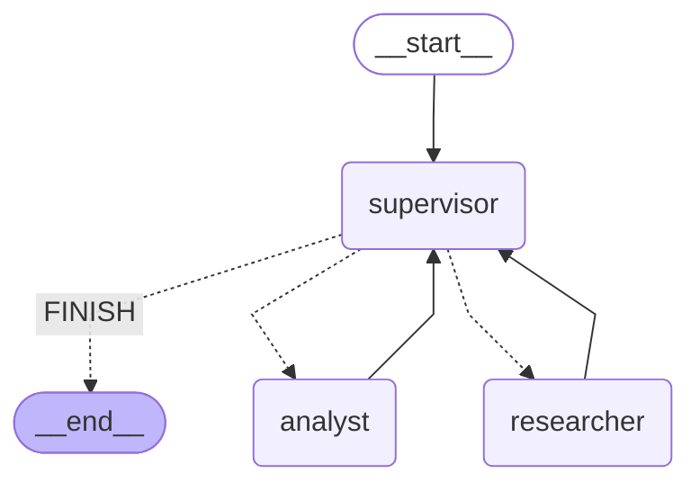

# orquestador — Pre-entrega 6

Orquestador multi-agente con topología jerárquica: un **supervisor** rutea entre
dos especialistas (**researcher** y **analyst**) y cierra la tarea cuando ambos
dominios aportaron lo suyo o se agota un presupuesto de pasos.

## Topología



Generado con `graph.get_graph().draw_mermaid()` sobre el grafo compilado
(no dibujado a mano): `uv run python scripts/export_graph.py` regenera
`docs/graph.mmd` y, si hay red, `docs/graph.png`.

**Por qué esta topología (star con supervisor):**

- Centraliza la decisión en un solo nodo: fácil de auditar y de limitar (un step
  budget). Topologías peer-to-peer son más flexibles pero más caras de controlar.
- Los workers son **stateless**: solo ven la instrucción concreta que el
  supervisor les pasa en `task`. El historial completo vive en `messages`, pero
  no se les reenvía (evita contaminación de contexto, como pide el enunciado).
- El supervisor acumula las contribuciones de cada worker en `contributions`
  (con reducer `operator.add`), y decide con esa vista estructurada —no con
  todo el historial sin resumir—.

## Estructura

```
src/orquestador/
  state.py                 # SupervisorState (TypedDict) + SupervisorDecision (Pydantic)
  llm.py                   # factory de ChatAnthropic (sin temperature)
  supervisor.py            # nodo supervisor con prompt, step budget, anti-repetición
  graph.py                 # build_graph(...) + build_graph_from_llm(...)
  agents/
    knowledge_base.py      # mini KB local (7 docs) + search() léxico
    research_agent.py      # create_react_agent + tool search_knowledge_base
    analyst_agent.py       # create_react_agent + 3 tools de cómputo determinista
scripts/
  demo.py                  # 3 queries que ejercitan rutas distintas del grafo
  export_graph.py          # genera docs/graph.mmd (+ PNG si hay red)
tests/                     # 24 tests sin red (schema, tools, supervisor, grafo e2e)
docs/graph.mmd             # diagrama del grafo
```

## Cómo correrlo

```bash
uv sync                               # instala langgraph 1.x, langchain-anthropic, pytest…
cp .env.example .env                  # completá ANTHROPIC_API_KEY
uv run python scripts/demo.py         # 3 queries con el LLM real (~15-25 llamadas a Haiku)
uv run pytest -q                      # 24 passed, sin red
uv run ruff check .                   # lint limpio
uv run python scripts/export_graph.py # regenera docs/graph.mmd (+ PNG si hay red)
```

Cambiar el modelo: `LLM_MODEL=claude-sonnet-5-5 uv run python scripts/demo.py`.

## Flujo de delegación (lo que demuestra `scripts/demo.py`)

Las 3 queries ejercitan rutas distintas del supervisor:

1. **Doble dominio** → `supervisor → researcher → supervisor → analyst → supervisor → END`.
   Fuerza al supervisor a delegar primero al investigador y después al analista.
2. **Solo búsqueda** → `supervisor → researcher → supervisor → END`. El supervisor
   detecta que la pregunta es puramente fáctica y no activa al analyst.
3. **Solo cálculo** → `supervisor → analyst → supervisor → END`. El cálculo no
   necesita documentación: el supervisor salta directo al analyst.

El script imprime cada paso con el formato `[N] <nodo> → <último mensaje>` y
cierra con un resumen que lista los agentes que contribuyeron y la respuesta
final del supervisor.

## Diseño del estado compartido

```python
class SupervisorState(MessagesState):
    next_agent: Literal["researcher", "analyst", "FINISH"]  # qué nodo activo ahora
    task: str  # instrucción del supervisor
    step: int  # contador contra loops
    task_completed: bool
    contributions: Annotated[list[Contribution], add]  # qué aportó cada agente
```

- `messages` viene de `MessagesState` con el reducer `add_messages`.
- `contributions` usa `operator.add`: cada worker devuelve una lista con su delta
  y LangGraph la mergea. Así el supervisor puede leer, en un solo lugar
  estructurado, qué agente aportó qué en cada paso.
- `next_agent` es un `Literal` que el conditional edge del supervisor lee para
  rutear (`add_conditional_edges("supervisor", lambda s: s["next_agent"], {...})`).

## Cómo se evita el "supervisor infinito"

Tres frenos independientes, cada uno suficiente por sí solo:

1. **Presupuesto duro** en `supervisor_node_factory(..., max_steps=6)`. Si el
   contador supera el límite, el nodo responde FINISH **sin consultar al LLM**.
2. **Rúbrica en el prompt** del supervisor: regla 1 ("si ya hay contribuciones
   de researcher Y analyst, DEBÉS FINISH"), regla 4 ("nunca pidas lo mismo dos
   veces al mismo agente").
3. **Detector de repetición en código**: si la decisión del LLM apunta al mismo
   agente con la misma instrucción que la última contribución, el nodo fuerza
   FINISH igual, aunque el LLM se empecine. Verificado por un test dedicado
   (`test_supervisor_blocks_repeat_same_agent_same_task`).

A eso se suma `recursion_limit=25` que LangGraph aplica por defecto como
última defensa.

## Cómo se evita la contaminación de contexto

Los workers **no reciben** todo el historial. Cada nodo worker toma únicamente
`state["task"]` (la instrucción puntual que el supervisor puso para él) y la
pasa como el único `HumanMessage` al `create_react_agent`. Las tools del
agente no ven el historial del supervisor, solo lo que necesitan para hacer
su trabajo.

El supervisor sí ve el historial completo (`messages`) y, además, la vista
resumida de `contributions`. Esa asimetría es intencional: el router necesita
contexto para decidir; los workers, no, para ir al grano.

## Validación de resultados

Dos capas:

- **Rúbrica del supervisor** (regla 5 del prompt): al cerrar con FINISH, el
  supervisor debe redactar la respuesta final citando los hallazgos. Si un
  worker no aportó nada útil, el supervisor igual cierra sin reintentar (regla
  del enunciado: "si el researcher no encontró información, igual terminá").
- **Salida estructurada en los bordes**: `model.with_structured_output(SupervisorDecision)`
  garantiza que la decisión del supervisor siempre tiene los tres campos
  (`next`, `reason`, `task`) y que `next` es uno de los tres literales. Si
  Pydantic falla la validación, langchain-anthropic levanta `OutputParserException`
  y el workflow corta.

## Costos y cosas a tener en cuenta

- `scripts/demo.py` hace unas 15–25 llamadas a `claude-haiku-5-5`, prompts cortos,
  centavos de dólar. Cada iteración del supervisor + un ReAct completo de un
  worker son 2–5 llamadas.
- Si querés usar Tavily en vez del KB local, reemplazá `search_knowledge_base`
  por `TavilySearchResults` (`pip install langchain-community tavily-python` +
  `TAVILY_API_KEY`). No es necesario para la entrega.
- Para recursión infinita del propio ReAct dentro de un worker (no del
  supervisor), LangGraph aplica su `recursion_limit` por defecto; no se toca
  acá para mantener el patrón simple.

## Tests

```bash
uv run pytest -q    # 24 passed
```

Cubre:

- **schema** (`SupervisorDecision`): acepta payload válido; rechaza nombre de
  agente inválido, `task` vacío y `reason` corto.
- **tools**: la búsqueda KB encuentra los docs y devuelve cadena fija cuando
  no hay hits; `contar_menciones` es case-insensitive; `calcular_estadisticas`
  da los números esperados y señaliza la lista vacía; `analizar_sentimiento`
  clasifica positivo/negativo/neutro.
- **supervisor**: rutea a researcher/analyst/FINISH según la decisión del LLM
  stub; presupuesto duro corta sin invocar al LLM; `max_steps=0` falla al
  construir; anti-repetición fuerza FINISH.
- **grafo e2e**: con nodos fake y un supervisor scripted:
  - flujo completo researcher → analyst → FINISH;
  - flujo single-domain (solo analyst);
  - presupuesto rompe un loop simulado (supervisor terco);
  - el Mermaid del grafo contiene los 5 nodos (`__start__`, `supervisor`,
    `researcher`, `analyst`, `__end__`).
